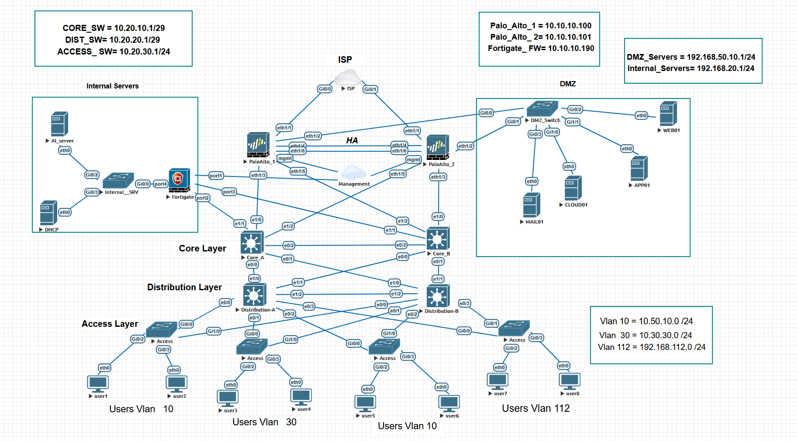

# Network Topology

This folder has the topology diagram for my Enterprise Network Lab, built in EVE-NG.

## What the diagram shows

- Core, Distribution and Access layers with redundant links between them
- User VLANs 10, 30 and 112
- Palo Alto firewalls in an HA pair, and a FortiGate firewall
- A DMZ with web, mail, app and cloud servers
- An internal servers network

## Addressing

All IP addresses in the diagram are private lab addresses. They are not from any production network.

